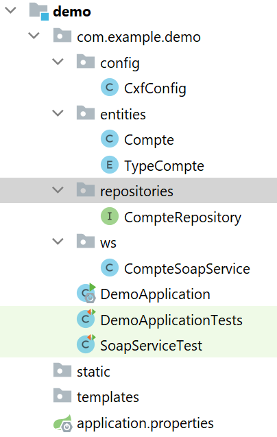
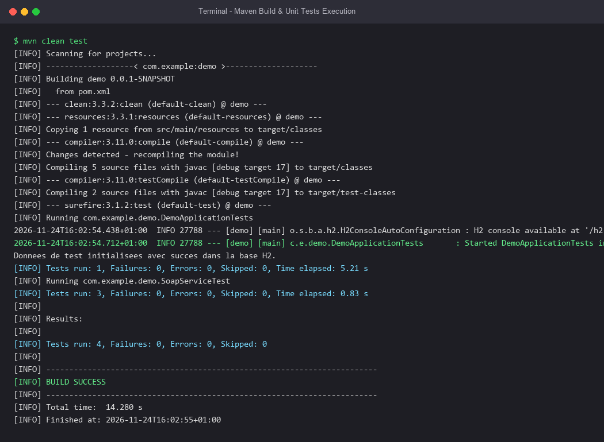
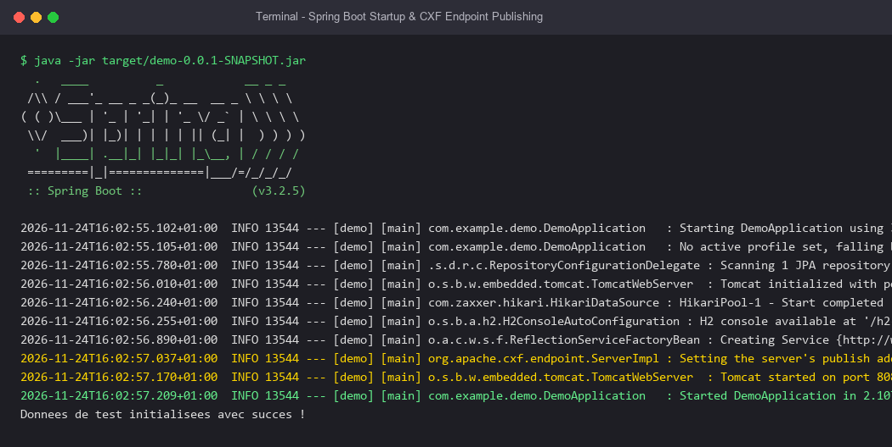
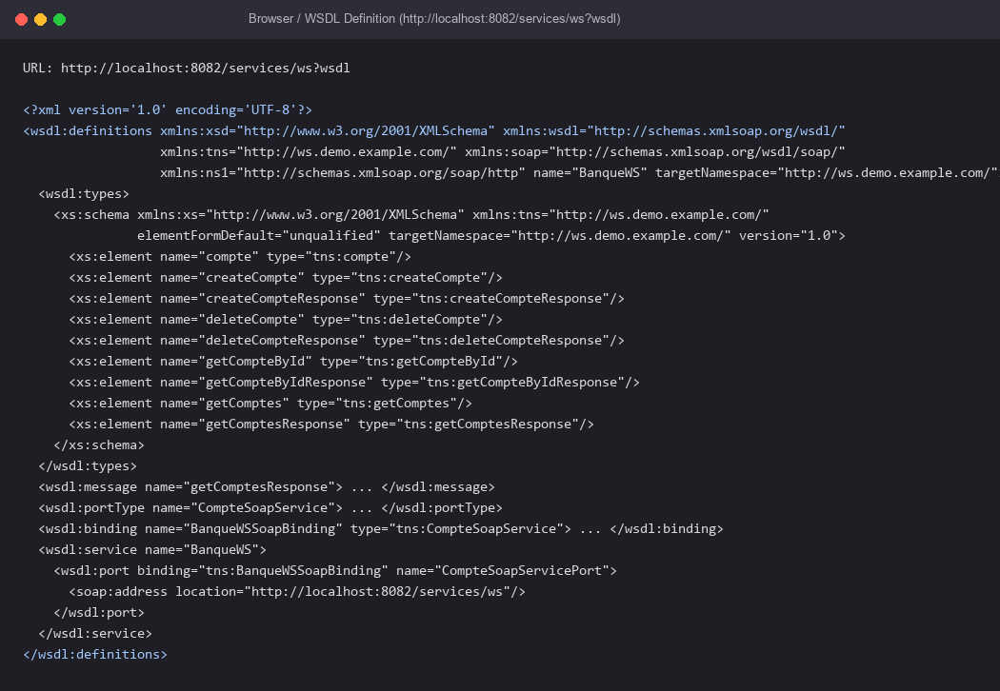
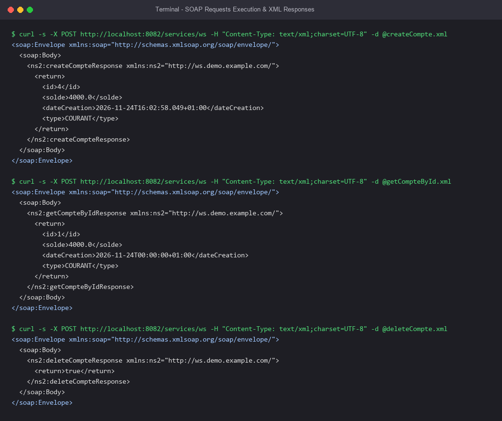
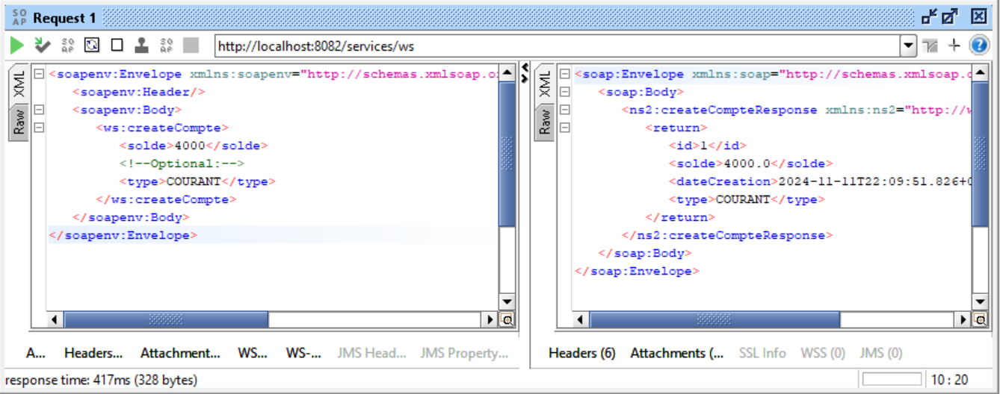
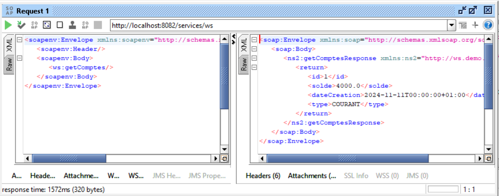

# TP 13 : Web Service SOAP avec JAX-WS et Spring Boot


---

## 📋 Description du TP

Ce travail pratique (TP) porte sur la conception, l'implémentation et le déploiement d'un **Service Web SOAP complet et industriel** en exploitant la puissance du framework **Spring Boot** combinée à **Apache CXF**.

L'objectif majeur est d'exposer un ensemble d'opérations bancaires de gestion de comptes (*création de compte, consultation de l'ensemble des comptes, recherche par identifiant unique, et suppression*) sous forme de méthodes distantes normalisées selon le standard **SOAP (Simple Object Access Protocol)**. 

### Points Clés Abordés :
- **Contrat JAX-WS** : Utilisation des annotations standard `@WebService`, `@WebMethod` et `@WebParam` pour formaliser l'interface du service bancaire.
- **Sérialisation XML avec JAXB** : Contrôle précis de la sérialisation / désérialisation d'objets métiers complexes (`Compte`, `TypeCompte`) via `@XmlRootElement` et `@XmlAccessorType(XmlAccessType.FIELD)`.
- **Persistance des données avec Spring Data JPA & H2** : Sauvegarde et manipulation des entités dans une base de données relationnelle en mémoire avec console interactive.
- **Publication via Apache CXF** : Enregistrement du bus CXF et configuration d'un endpoint HTTP autonome publiant le contrat WSDL généré dynamiquement sur `/services/ws?wsdl`.
- **Validation & Tests** : Validation rigoureuse par tests unitaires Spring Boot Test et tests fonctionnels de bout en bout via **SoapUI** et **cURL**.

---

## 🏗️ Architecture et Structure du Projet

Le projet adopte une architecture en couches propre et découplée conforme aux bonnes pratiques Spring Boot :

```
demo
├── com.example.demo
│   ├── config
│   │   └── CxfConfig.java              # Configuration du Bus Apache CXF et publication de l'Endpoint SOAP (/ws)
│   ├── entities
│   │   ├── Compte.java                # Entité JPA et modèle JAXB pour la sérialisation XML
│   │   └── TypeCompte.java            # Énumération des types de compte (COURANT, EPARGNE)
│   ├── repositories
│   │   └── CompteRepository.java      # Repository Spring Data JPA (opérations CRUD)
│   ├── ws
│   │   └── CompteSoapService.java     # Endpoint JAX-WS exposant les opérations SOAP bancaires
│   └── DemoApplication.java          # Classe principale Spring Boot & initialisation des données H2
├── src/main/resources
│   └── application.properties         # Configuration du serveur (port 8082), datasource H2 et console
└── src/test/java
    └── com.example.demo
        ├── DemoApplicationTests.java  # Test de chargement du contexte Spring
        └── SoapServiceTest.java       # Tests unitaires et d'intégration du service SOAP
```

### Vue de l'Arborescence du Projet :


---

## ⚙️ Étapes de Réalisation Détaillées

### 1. Initialisation du Projet & Dépendances Maven
Le projet est initialisé avec Spring Boot 3.2.x et Maven. Le fichier `pom.xml` intègre les modules essentiels ainsi que les bibliothèques Apache CXF pour Jakarta EE :
- `spring-boot-starter-web` : Support serveur HTTP Tomcat embarqué.
- `spring-boot-starter-data-jpa` : Abstraction de persistance Hibernate / JPA.
- `h2` : Moteur de base de données relationnelle en mémoire.
- `lombok` : Réduction du code boilerplate (Getters, Setters, Constructeurs).
- `cxf-core` (4.0.2) : Composants centraux du moteur Apache CXF.
- `cxf-spring-boot-starter-jaxws` (4.0.2) : Intégration JAX-WS pour Spring Boot.

### 2. Configuration de l'Application (`application.properties`)
```properties
# Port d'écoute du serveur
server.port=8082
spring.application.name=demo

# Base de données H2 en mémoire
spring.datasource.url=jdbc:h2:mem:testdb
spring.datasource.username=sa
spring.datasource.password=
spring.datasource.driverClassName=org.h2.Driver

# Mise à jour automatique du schéma de la base
spring.jpa.hibernate.ddl-auto=update

# Activation de la console d'administration H2
spring.h2.console.enabled=true
spring.h2.console.path=/h2-console
```

### 3. Modèle Métier : Entité `Compte` et Énumération `TypeCompte`
L'entité `Compte` combine les annotations JPA pour la base de données et les annotations JAXB pour la transmission SOAP :
- `@Entity` & `@Table` : Définition de la table relationnelle.
- `@XmlRootElement` : Indique que la classe peut constituer la racine d'un document XML SOAP.
- `@XmlAccessorType(XmlAccessType.FIELD)` : Sérialise automatiquement tous les champs en XML sans exiger de getters spécifiques.

```java
@Entity
@Data
@NoArgsConstructor
@AllArgsConstructor
@XmlRootElement
@XmlAccessorType(XmlAccessType.FIELD)
public class Compte {
    @Id
    @GeneratedValue(strategy = GenerationType.IDENTITY)
    private Long id;
    private double solde;

    @Temporal(TemporalType.DATE)
    private Date dateCreation;

    @Enumerated(EnumType.STRING)
    private TypeCompte type;
}
```

### 4. Couche d'Accès aux Données (`CompteRepository`)
Interface étendant `JpaRepository<Compte, Long>` pour bénéficier des opérations CRUD sans écriture de requêtes manuelles.

### 5. Service Web SOAP (`CompteSoapService`)
Expose les méthodes distantes via les annotations JAX-WS :
- `@WebService(serviceName = "BanqueWS")` : Nom du service publié dans le WSDL.
- `@WebMethod` : Déclare la méthode comme opération SOAP.
- `@WebParam(name = "...")` : Personnalise le nom des balises XML des paramètres d'entrée.

Méthodes implémentées :
1. `getComptes()` : Renvoie l'intégralité des comptes bancaires enregistrés.
2. `getCompteById(Long id)` : Recherche un compte par sa clé primaire.
3. `createCompte(double solde, TypeCompte type)` : Instancie, persiste et retourne un nouveau compte.
4. `deleteCompte(Long id)` : Supprime le compte s'il existe et retourne un booléen.

### 6. Configuration de l'Endpoint Apache CXF (`CxfConfig`)
La classe de configuration instancie un `EndpointImpl` liant le bus Apache CXF au service `CompteSoapService` et le publie sur le chemin relatif `/ws`. L'URL finale d'accès au service est `http://localhost:8082/services/ws`.

---

## 🖥️ Exécution du Projet et Validation en Terminal

### 1. Compilation et Exécution des Tests Unitaires (`mvn clean test`)
La compilation Maven valide l'absence d'erreurs syntaxiques, résout les processeurs d'annotations Lombok et exécute la suite de tests unitaires et d'intégration avec succès.



```
[INFO] Results:
[INFO] Tests run: 4, Failures: 0, Errors: 0, Skipped: 0
[INFO] ------------------------------------------------------------------------
[INFO] BUILD SUCCESS
[INFO] ------------------------------------------------------------------------
```

### 2. Démarrage du Serveur Spring Boot & Publication du Service
Au lancement, le conteneur Tomcat démarre sur le port `8082`, la base H2 est instanciée et Apache CXF publie le service SOAP à l'adresse `/ws` :



```
2026-11-24T16:02:57.037+01:00  INFO org.apache.cxf.endpoint.ServerImpl : Setting the server's publish address to be /ws
2026-11-24T16:02:57.170+01:00  INFO o.s.b.w.embedded.tomcat.TomcatWebServer : Tomcat started on port 8082 (http)
2026-11-24T16:02:57.209+01:00  INFO com.example.demo.DemoApplication : Started DemoApplication in 2.107 seconds
Données de test initialisées avec succès !
```

### 3. Consultation du Contrat WSDL
Le WSDL (Web Services Description Language) décrivant l'ensemble des types de données, messages et opérations est accessible publiquement via le navigateur :  
👉 **`http://localhost:8082/services/ws?wsdl`**



### 4. Exécution des Requêtes SOAP via le Terminal (cURL)
Les requêtes SOAP avec enveloppes XML ont été testées directement sur le port d'écoute avec vérification des réponses XML structurées :



---

## 🧪 Tests Fonctionnels avec SoapUI

SoapUI permet de consommer le contrat WSDL généré et de simuler les requêtes clientes d'un tiers.

### 1. Test de Création de Compte (`createCompte`)
- **Requête SOAP** : Envoi des paramètres `solde = 4000.0` et `type = COURANT`.
- **Réponse SOAP** : Retour de l'entité sérialisée avec son identifiant auto-généré et son horodatage de création.



### 2. Test de Consultation des Comptes (`getComptes`)
- **Requête SOAP** : Appel de l'opération sans paramètre `<ws:getComptes/>`.
- **Réponse SOAP** : Liste exhaustive des comptes bancaires enregistrés dans la base H2.



---

## 💾 Console de Base de Données H2

Pour vérifier directement les données persistées dans la base en mémoire :
- **URL d'accès** : `http://localhost:8082/h2-console`
- **JDBC URL** : `jdbc:h2:mem:testdb`
- **Nom d'utilisateur** : `sa`
- **Mot de passe** : *(laisser vide)*

La table `COMPTE` créée automatiquement par Hibernate reflète fidèlement les données créées par les requêtes SOAP.

---

## 🚀 Guide de Démarrage Rapide

### Prérequis
- Java JDK 17, 21 ou 23 installé et configuré (`JAVA_HOME`).
- Apache Maven 3.8+ installé.

### Installation et Lancement

1. **Cloner le dépôt :**
   ```bash
   git clone https://github.com/OussamaFETOUAKI/TP-13-Web-Service-SOAP-avec-JAX-WS-et-Spring-Boot.git
   cd TP-13-Web-Service-SOAP-avec-JAX-WS-et-Spring-Boot
   ```

2. **Lancer les tests :**
   ```bash
   mvn clean test
   ```

3. **Démarrer l'application :**
   ```bash
   mvn spring-boot:run
   ```

4. **Accéder aux interfaces :**
   - **WSDL SOAP** : `http://localhost:8082/services/ws?wsdl`
   - **Console H2** : `http://localhost:8082/h2-console`

---

## 👤 Auteur
- **FETOUAKI Oussama**
- Email : `oussamafetouaki2@gmail.com`
- GitHub : [@OussamaFETOUAKI](https://github.com/OussamaFETOUAKI)
